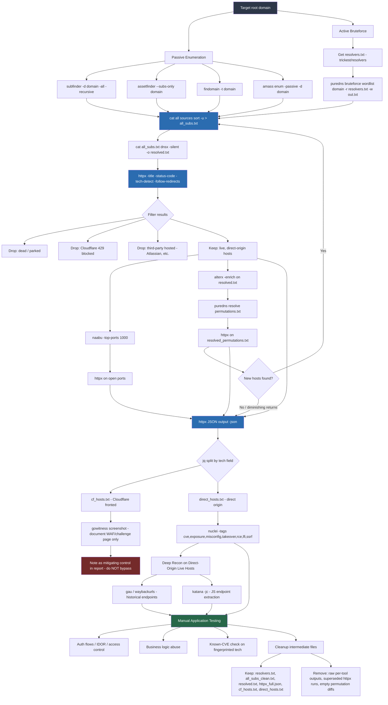

# Bug Bounty / VDP Recon Methodology

> Personal reference workflow — subdomain discovery → validation → live service triage → permutation pass → manual pivot. Built and tested during BorgWarner VDP engagement (Intigriti), Nov 2026.

---

## 1. Workflow Diagram



---

## 2. Scoping & Rules-of-Engagement Check (do this FIRST, every time)

Before touching anything, read the program policy and note:

- [ ] Is automated tooling allowed? Any required headers/UA strings?
- [ ] Is bypassing rate-limits / WAF explicitly **out of scope**? (common clause — if so, never VPN-hop past a 429)
- [ ] Are "verbose directory listing / version disclosure without sensitive data" excluded? (very common — affects how you score shortname/banner-grab findings)
- [ ] Which sub-assets are third-party hosted (Atlassian, Azure Static Web Apps, CDN-fronted SaaS)? → usually out of scope, you're not testing the vendor
- [ ] Device/hardware PSIRT categories ≠ remote web targets — skip unless you own the hardware

**Lesson learned on this engagement:** an IIS shortname (8.3) disclosure was chased hard before realizing the program explicitly excludes "verbose listings without sensitive info disclosure" — check policy *before* investing hours, not after.

---

## 3. Passive Subdomain Enumeration

```bash
subfinder -d target.com -all -recursive -silent -o subfinder.txt
assetfinder --subs-only target.com > assetfinder.txt
findomain -t target.com -q -u findomain.txt
amass enum -passive -d target.com -o amass.txt
# chaos -d target.com -silent -o chaos.txt   # requires PDCP_API_KEY (projectdiscovery.io signup)
```

---

## 4. Active Bruteforce (catches what passive misses)

```bash
# Resolvers list (public, community-validated)
curl -s https://raw.githubusercontent.com/trickest/resolvers/main/resolvers.txt -o resolvers.txt

# Optional: validate resolvers yourself for higher reliability on large jobs
pip3 install dnsvalidator --break-system-packages
dnsvalidator -tL resolvers.txt -threads 50 -o resolvers_validated.txt

# Bruteforce — note flag is -w/--write, NOT -o
puredns bruteforce /usr/share/seclists/Discovery/DNS/subdomains-top1million-5000.txt target.com \
  -r resolvers.txt -w puredns_brute.txt
```

---

## 5. Merge, Dedupe, Validate

```bash
cat subfinder.txt assetfinder.txt findomain.txt amass.txt puredns_brute.txt 2>/dev/null \
  | sort -u > all_subs.txt
wc -l all_subs.txt

# Clean any markdown-link-wrapped entries if copy-pasted from a rendered source
sed -E 's/\[([^]]+)\]\([^)]+\)/\1/' all_subs.txt | sort -u > all_subs_clean.txt

# Confirm hosts actually resolve before wasting httpx cycles
cat all_subs_clean.txt | dnsx -silent -o resolved.txt
wc -l resolved.txt
```

---

## 6. Live HTTP Triage

```bash
httpx -l resolved.txt -title -status-code -tech-detect -follow-redirects -o httpx_results.txt
```

**Triage rules of thumb:**

| Signal | Action |
| --- | --- |
| `429` + `Cloudflare` | Rate-limited/WAF'd — do NOT VPN-hop past it if policy excludes rate-limit bypass |
| `403` + Atlassian/Azure Static Web Apps/third-party banner | Likely out of scope — you'd be testing the vendor, not the target |
| `200` on dev/test/staging naming pattern | High priority — weaker hardening common |
| Acquired-brand domains (legacy product lines) | High priority — often lag behind parent-company security baseline |
| Generic `200` on main corp domain | Still worth a manual pass, lower urgency than above |

---

## 7. Port Discovery (non-standard services)

```bash
naabu -l resolved.txt -top-ports 1000 -o naabu_results.txt
httpx -l naabu_results.txt -title -status-code -tech-detect -follow-redirects -o httpx_ports_results.txt
```

Ports worth explicitly checking for forgotten admin/management UIs: `8080, 8443, 8000, 8888, 10000 (Webmin), 7001 (WebLogic), 9090, 9443, 4443, 8181`

---

## 8. Permutation / Mutation Pass

Run this **after** you have real confirmed hosts — alterx needs genuine patterns to mutate, not a blind wordlist.

```bash
cat resolved.txt | alterx -enrich -o permutations.txt
wc -l permutations.txt

puredns resolve permutations.txt -r resolvers.txt -w resolved_permutations.txt
httpx -l resolved_permutations.txt -title -status-code -tech-detect -follow-redirects -o httpx_permutations.txt

# Isolate genuinely new finds vs. first pass
comm -23 <(sort resolved_permutations.txt) <(sort resolved.txt) > new_only.txt
wc -l new_only.txt
```

---

## 8.5 WAF Split: Cloudflare vs. Direct-Origin, Then Scoped Nuclei

Once you have a settled live-host list (first pass + permutation pass combined), re-run httpx with JSON output so you can split programmatically rather than eyeballing tech-detect strings.

```bash
httpx -l resolved.txt -title -status-code -tech-detect -follow-redirects -json -o httpx_full.json
```

```bash
# Hosts fronted by Cloudflare (or any WAF flagged in tech-detect)
cat httpx_full.json | jq -r 'select(.tech[]? | test("Cloudflare"; "i")) | .url' > cf_hosts.txt

# Direct-origin hosts — your real, testable attack surface
cat httpx_full.json | jq -r 'select([.tech[]? | test("Cloudflare"; "i")] | length == 0) | .url' > direct_hosts.txt

wc -l cf_hosts.txt direct_hosts.txt
```

**Cloudflare group → screenshot for documentation only, never bypass:**

```bash
gowitness file -f cf_hosts.txt --screenshot-path cf_screenshots/
```

This is purely to visually confirm what's blocking you (challenge page, 403, 429) for your own notes / as a "mitigating control" line in a report. Per most VDP policies, bypassing rate-limits/WAF is explicitly out of scope — don't VPN-hop or header-trick your way past these.

**Direct-origin group → straight to nuclei:**

```bash
nuclei -l direct_hosts.txt \
  -tags cve,exposure,misconfig,takeover,default-login,rce,lfi,ssrf \
  -severity low,medium,high,critical \
  -rate-limit 20 -c 10 \
  -o nuclei_direct_results.txt
```

Severity threshold loosened to `low` when the direct-origin set is small (a handful of hosts) — cheap to manually triage every finding when the list is short; tighten back to `medium,high,critical` for large batches.

---

## 9. Deeper Recon on Confirmed Live Hosts (before going manual)

```bash
# Historical endpoints / parameters
gau target.com --subs | tee gau_urls.txt
# or: waybackurls target.com | tee wayback_urls.txt

# JS-aware crawl for hidden endpoints
katana -u https://live-host.target.com -jc -o js_urls.txt

# Visual triage of everything found so far
httpx -l httpx_results.txt -screenshot -o screenshots/
# or: gowitness file -f httpx_results.txt
```

---

## 10. Pivot to Manual Testing

Once recon stalls (permutation pass returns nothing new, diminishing returns on wordlists), **stop adding tooling and go manual.** Recon can expand forever; impact comes from app-level testing:

- Authentication flows, IDOR, broken access control
- Business-logic abuse (not brute force — most VDPs exclude that)
- Known-CVE check against exact fingerprinted versions (confirm exploitability, don't just cite CVE existence)
- Self-register where allowed (check program FAQ) and test authenticated paths

---

## 11. Tooling Quick-Reference / Gotchas Log

| Issue | Fix |
| --- | --- |
| `go install` binary not found after install | `asdf reshim golang` if using asdf for Go version mgmt |
| `puredns` `-o` flag not recognized | Correct flag is `-w` / `--write`, not `-o` |
| `chaos` fails with `PDCP_API_KEY not specified` | Free signup at cloud.projectdiscovery.io |
| Corrupted/un-removable directory (`d?????????` in `ls -la`) | Overlayfs inode corruption (common in Docker/Exegol) — try `rm -rf`, then `find . -delete`; if both fail, just work in a renamed folder, don't fight the inode |
| Scan gets `429` on Cloudflare-fronted target | Back off entirely — do not rotate IP/VPN if program excludes rate-limit bypass |

---

## 12. Workspace Cleanup (once a target's recon phase is done)

Raw per-tool outputs are only useful until they're merged — once `all_subs_clean.txt` / `resolved.txt` / `httpx_full.json` exist, the intermediates are noise. Clean up before moving to the next target so folders don't pile up with stale files:

```bash
# Keep: resolvers.txt, all_subs_clean.txt, resolved.txt, httpx_full.json, cf_hosts.txt, direct_hosts.txt

# Remove once merged/superseded:
rm -f assetfinder.txt findomain.txt subfinder.txt amass.txt puredns_brute.txt
rm -f permutations.txt resolved_permutations.txt
rm -f httpx_ports.txt httpx_final_check.txt
rm -f new_only.txt

# Check any unexpected leftover config/state files before deleting (e.g. resume.cfg from puredns/massdns)
cat resume.cfg 2>/dev/null
```

---

## 13. Severity-Scoping Reminders (don't waste hours before checking)

- Version/banner disclosure alone → usually **out of scope** on most VDPs
- Directory/file listing without sensitive content → usually **out of scope**
- Blind SSRF without proven business impact → usually **out of scope**
- Bypassing rate-limits or WAF → usually **out of scope**, sometimes a ToS violation
- Always confirm program's exact out-of-scope list before investing deep effort chasing a lead

---

*Last updated: Nov 25, 2026 — BorgWarner VDP engagement notes (added JSON-based WAF/direct-origin split, gowitness documentation step, scoped nuclei pass, and workspace cleanup stage).*